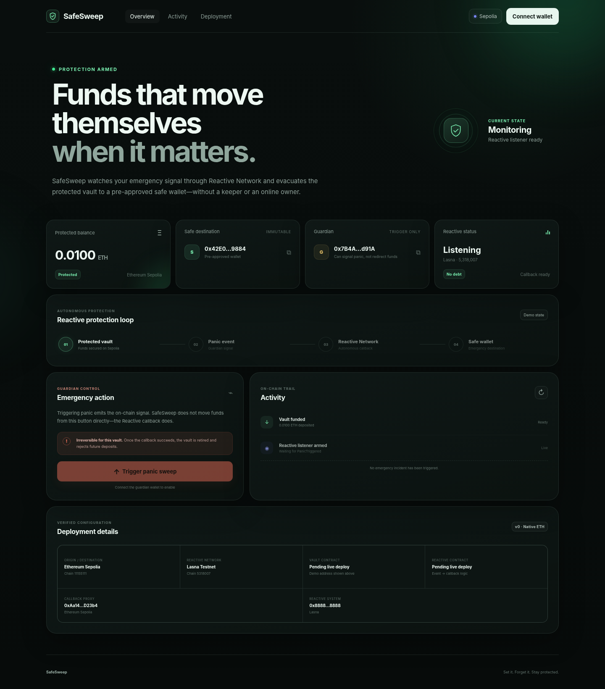

# SafeSweep

**Guardian panic on Base Sepolia → Reactive decision on Lasna → authenticated callback on Base Sepolia → funds in an immutable safe wallet.**

SafeSweep is a keeperless emergency fund-evacuation layer built with Reactive Contracts. A trusted guardian only emits the panic signal; Reactive Network observes that origin event, makes the autonomous callback request, and the vault sweeps its remaining native balance to a pre-approved destination. No bot, keeper, or online owner is required after the panic transaction.

## Reactive loop

```text
SafeSweepVault.panic()
        |
        v
PanicTriggered event (origin chain)
        |
        v
SafeSweepReactive.react() (Lasna)
        |
        v
requestCallbackV_1_0()
        |
        v
SafeSweepVault.sweep() (origin chain)
        |
        v
SAFE WALLET
```

## Contracts

- `src/SafeSweepReactive.sol` — event subscription + reaction + callback request.
- `src/SafeSweepVault.sol` — protected funds + panic event + authenticated sweep callback.
- `docs/SECURITY.md` — v0 threat model, invariants, adversarial tests, and known limitations.

## v0 scope

One trigger only: **explicit guardian panic**.

One protected asset only: **native currency**.

One safety destination: **immutable safe wallet**. The v0 live demo requires that safe wallet to be an EOA so the native-ETH evacuation cannot be rejected by destination code.

This keeps the demo focused on the required `origin event -> Reactive logic -> destination callback` proof.

## Toolchain

Solidity `0.8.29` + Foundry. SafeSweep targets Reactive Network's current Omni architecture.

The Reactive Omni library is pinned as a Git submodule under `lib/reactive-lib-omni`. With Foundry installed, run:

```bash
git submodule update --init lib/reactive-lib-omni
forge build
forge test -vvv
```


## One-command operator flow

SafeSweep now exposes the common build, rehearsal, deployment, panic, proof, and dashboard actions through one CLI:

```bash
./scripts/safesweep.sh check
./scripts/safesweep.sh rehearse
./scripts/safesweep.sh init
./scripts/safesweep.sh wallet-import
./scripts/safesweep.sh preflight
./scripts/safesweep.sh deploy
./scripts/safesweep.sh panic
./scripts/safesweep.sh proof 0x<reactive-tx> 0x<callback-tx>
./scripts/safesweep.sh apply-ui
```

For live use, the recommended signer is a dedicated testnet key stored in Foundry's encrypted local keystore. The key does not need to be placed in `.env`. See `scripts/deploy/README.md`.

## Deployment proof checklist

- [ ] SafeSweepReactive address on Lasna
- [ ] SafeSweepVault address on origin testnet
- [ ] Origin `panic()` tx hash
- [ ] Reactive transaction / callback request tx hash
- [ ] Destination `sweep()` tx hash
- [ ] Safe wallet balance increase visible in explorer
- [ ] Demo video under 3 minutes

See `project.md` for the full project brief, `docs/ARCHITECTURE.md` for the v0 design, `docs/SECURITY.md` for the security review, `docs/EVIDENCE.md` for proof capture, and `docs/DEMO.md` for the 30–60 second and under-3-minute demo scripts.

## Reproducible dependency pin

SafeSweep pins Reactive Network's Omni Solidity library at commit:

```text
3ade0dcf1d27e67e5783ef807e73a1b9e0c0cce8
```

See `docs/DEPENDENCIES.md`. Do not swap this to a floating branch for the submission build.

## Tests

The local suite covers:

- one-shot configuration and event subscription
- guardian-only panic signalling
- panic does not move funds directly
- callback-proxy authentication
- Reactive-contract authentication
- successful full native-balance evacuation
- replay / second-sweep rejection
- rejection of panic after evacuation
- Reactive callback request shape and payload
- safe fall-through for unrelated Reactive logs
- unauthorized `react()` rejection
- zero callback-proxy constructor rejection
- duplicate origin-log suppression
- owner-only Reactive configuration
- rejecting safe-wallet atomic rollback
- reentrant safe-wallet double-sweep prevention
- direct unauthorized fee-payment rejection

Run all contract checks with:

```bash
./scripts/check.sh
```

CI mirrors the same checks in `.github/workflows/ci.yml`. The current local checkpoint is **28 passed / 0 failed / 0 skipped**; see `docs/VALIDATION.md`.

For a no-funds end-to-end rehearsal of the Lasna/Base Sepolia deployment and sweep flow, run:

```bash
./scripts/local/rehearse.sh
```

The rehearsal uses two local Anvil chains with the production chain IDs and fixed system/proxy addresses. Its transaction hashes are deliberately **not** submission evidence.

## Dashboard

The dependency-free dashboard lives in `web/`. It includes wallet connection, live vault reads, guardian-only panic submission, the four-stage Reactive timeline, proof/explorer links, and explicit pending/swept/error states. Before live addresses exist it renders a clearly labelled demo state.



After a real deployment, apply its public manifest with:

```bash
./scripts/web/apply-manifest.py deployments/base-sepolia-<timestamp>.json
```

Then serve locally with `python3 -m http.server 4173 -d web`.

## Shipping tracker

See `docs/ROADMAP.md` for the numbered build order and current completion state.


## Demo deployment target

SafeSweep v0 is wired for **Base Sepolia** (`84532`) as both the origin and callback destination, with the Reactive contract on **Lasna** (`5318007`). The current Base Sepolia callback proxy is `0x476F44b11F5C942c58f4c8E3d0300E5710743585`.

The reproducible deployment sequence lives in `scripts/deploy/README.md`. It deploys Reactive first, then the vault, configures the subscription, funds Reactive and callback reserves through `depositTo`, funds the protected vault, and checks status. The guardian panic is deliberately a separate evidence-capture step.
