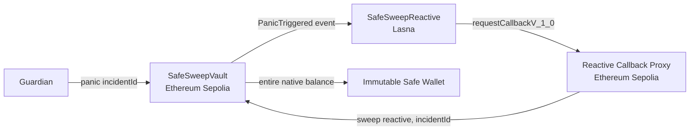

# SafeSweep v0 Architecture

## Goal

Prove one undeniable Reactive loop:

`guardian panic tx -> PanicTriggered event -> SafeSweepReactive.react() -> callback -> SafeSweepVault.sweep() -> safe wallet`

## End-to-end flow

The guardian never supplies a destination. The vault destination and authorized Reactive sender are immutable, while the Reactive subscription/configuration is one-shot.

## Components

### 1. SafeSweepVault (origin + callback recipient)
- Holds native funds.
- Has an immutable guardian.
- Has an immutable safe wallet.
- `panic(incidentId)` only emits the emergency signal; it cannot directly move funds.
- `sweep(reactive, incidentId)` is authenticated by both the destination callback proxy and the configured Reactive contract.
- On a valid callback, all remaining native balance is sent to the safe wallet.

### 2. SafeSweepReactive (Lasna)
- Deployed first.
- Configured once after the vault exists.
- Subscribes to the vault's `PanicTriggered` event.
- On a valid panic log, deduplicates the source record and requests a V1 callback to the vault.
- No keeper, cron job, bot, or human follow-up transaction is required.

## Why same-chain for v0

The project brief allows same-chain or cross-chain evacuation. The v0 demo keeps the vault and safe wallet on one EVM chain so the proof is about Reactive automation rather than bridge mechanics. Cross-chain asset movement can be added later through a bridge adapter without changing the event -> reaction -> callback story.

## Deployment order

The constructor/configuration dependency is intentional: the vault permanently authenticates one Reactive contract, while the Reactive contract needs the vault address only during its one-time `configure()` call.

| Stage | Chain | Action | Required values |
| --- | --- | --- | --- |
| 1 | Lasna | Deploy `SafeSweepReactive` | deployer becomes immutable `owner` |
| 2 | Sepolia | Deploy `SafeSweepVault` | callback proxy, Reactive address, guardian, immutable safe wallet |
| 3 | Lasna | `configure(...)` | Sepolia chain ID, vault address, Sepolia destination chain ID, vault callback recipient |
| 4 | Lasna | Fund Reactive reserve | `SYSTEM.depositTo(reactive)` |
| 5 | Sepolia | Fund callback reserve | `CALLBACK_PROXY.depositTo(vault)` |
| 6 | Sepolia | Fund protected vault | demo native ETH |
| 7 | Sepolia | Guardian calls `panic(incidentId)` | guardian signer + incident ID |
| 8 | Both | Capture proof | origin tx, Reactive tx, destination callback tx |

The executable runbook is `scripts/deploy/README.md`; `./scripts/deploy/ship-live.sh` performs stages 1–6 in one controlled run and deliberately stops before the panic so evidence capture can be prepared.

## v0 security properties

- Guardian cannot redirect funds; it can only trigger panic.
- Safe wallet cannot be changed after deployment.
- Direct external calls to `sweep()` fail unless they come through the callback proxy.
- A callback from an untrusted Reactive contract fails.
- Sweep is one-shot and reentrancy-safe by setting `swept` before the external transfer.
- Duplicate source logs are suppressed before requesting another callback.
- A rejecting safe wallet causes an atomic rollback, leaving funds in the vault.

## Deferred intentionally

- ERC-20 sweeps.
- Approval revocation.
- Large-transfer anomaly detection.
- Malicious-contract deny lists.
- Heartbeats.
- Destination rotation with timelock / guardian co-approval.
- Cross-chain bridge adapters.

## v0 demo networks (verified 2026-11-18)

SafeSweep v0 uses the same EVM testnet for the origin event and destination callback to keep the demo focused on the Reactive loop rather than bridging complexity:

- Origin/destination: Ethereum Sepolia (`11155111`)
- Reactive chain: Lasna (`5318007`)
- Reactive system: `0x8888888888888888888888888888888888888888`
- Sepolia callback proxy: `0xAa14d9Cd0f788Ca23d11805986C1d8bd035D23b4`

Deployment order is intentionally asymmetric: deploy the Reactive contract first, deploy the vault with the Reactive address embedded as its immutable callback sender, then call the one-shot `configure()` on the Reactive contract with the vault address.

Callback billing is funded through the callback proxy's `depositTo(vault)` reserve. This avoids treating the protected vault balance as the intended fee reserve and makes the demo's evacuation accounting easier to explain.
